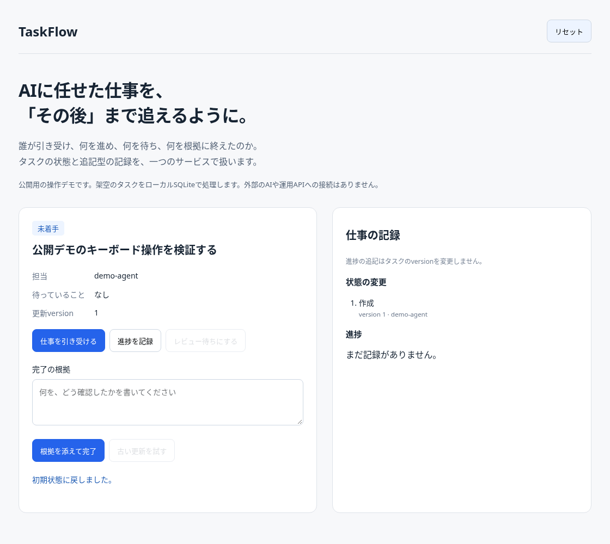
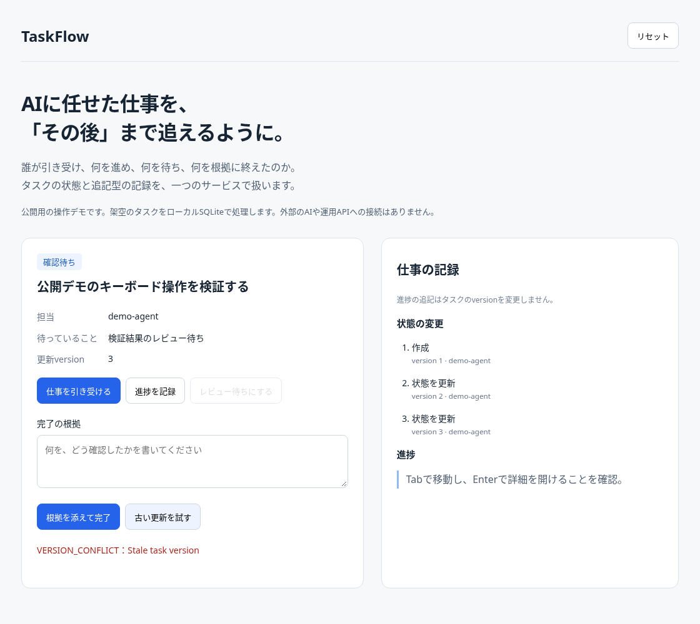
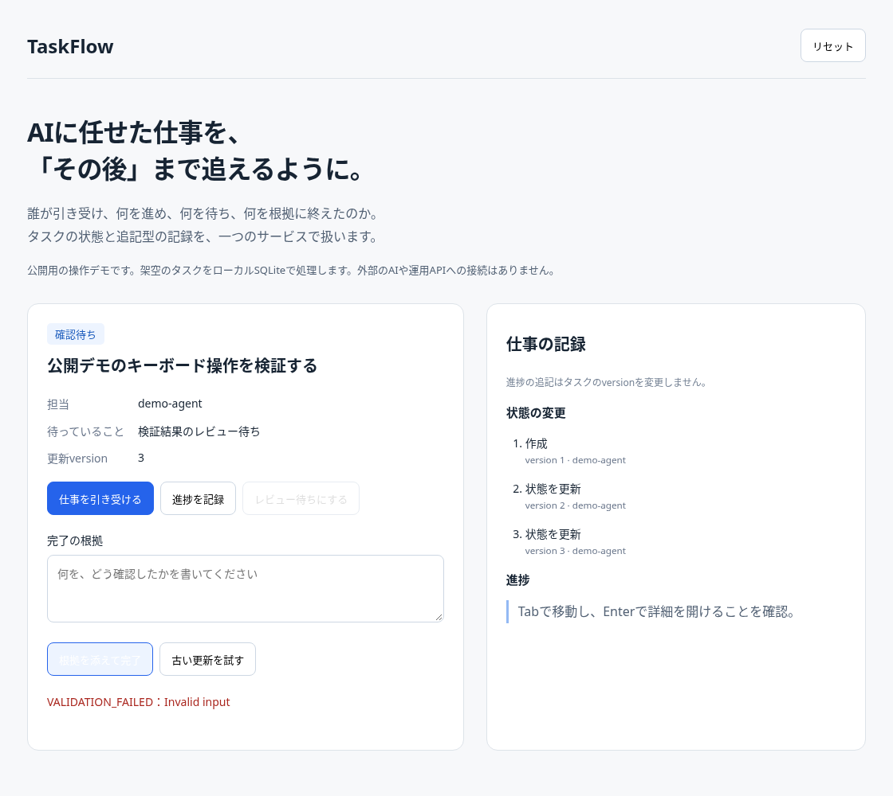
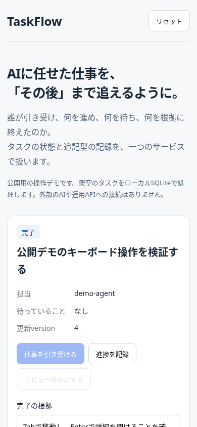

# TaskFlow

A shared task store for people and multiple AI agents to hand off work and the context needed to continue it.<br>
TaskFlow records ownership, progress, waiting conditions, and completion evidence alongside references to shared knowledge.<br>
This public demo runs the core service locally with fictional data; live agent connections are not included.

**複数のAIと人が、コンテキストと仕事を渡し合うための共通のタスクストア。**

## 課題：別のAIが、続きから仕事を進められるようにしたい

Muse、ChatGPT、dots、Grok Botの複数のbot、Codex、そして人。
それぞれが別の会話や作業環境を持つ中で協働するには、依頼を伝えるだけでなく、次の相手が続けられるコンテキストも渡す必要があります。
何を頼まれ、どの資料を参照し、どこまで進み、誰の何を待っているのか。
その情報が個々の会話に閉じると、担当が変わるたびに説明し直すことになります。

Notionならファイル・資料・調査メモを共有できます。
しかし、資料の置き場と「今、誰がこの仕事を引き受け、次に何をするか」は分けて扱いたい。
複数のAIが同じ仕事に触れても、再送で記録が増えたり、古い情報で状態が上書きされたりしない足場が必要でした。
これが、AIエージェントを人と協働させるために、AIファーストなTODOリストを作った動機です。

## 解決のアプローチ：知識への参照と、仕事の状態を一緒に渡す

TaskFlowを共有の作業状態の置き場にし、タスクに目的・完了条件・資料への参照・進捗・待機理由を残します。
次の担当は、その記録と参照先を読んでから仕事を引き受けます。
人やエージェントが記録を残し、次の相手が読んで再開するための構成です。
会話履歴やモデル内部のコンテキストを自動転送する機能ではありません。

公開コードには、説明の`notes`、完了条件の`definition_of_done`、資料への参照の`context_refs`があります
（[`contracts/index.ts:53`](src/v1/contracts/index.ts#L53)）。
進捗や完了根拠にも`source_ref`を添えられます
（[`contracts/index.ts:37`](src/v1/contracts/index.ts#L37)、[`contracts/index.ts:257`](src/v1/contracts/index.ts#L257)）。
NotionのページURLも参照として保持できますが、リンク先の取得・同期やNotion側へのリンク作成は行いません。

## なぜタスクをNotionから分けたのか

資料を共有できることと、複数の書き手が同じ作業状態を安全に更新できることは、別の要件です。
文書を読む・編集するだけの運用に、担当の受諾、再送の扱い、競合時の拒否、完了条件の検査まで委ねず、TaskFlowのサービスとDBで明示的に扱うことにしました。
Notion全体の機能の有無を比較するのではなく、協働に必要な作業上のルールをどこで保証するか、という役割分担です。

| 置き場 | 共有するもの | つなぎ方 |
| --- | --- | --- |
| Notion＝共有の知識・文書 | ファイル・資料・調査メモ・決定理由 | 文書から関連タスクを参照する運用 |
| TaskFlow＝共有の作業状態 | 担当・状態・進捗・待機・引き継ぎ・完了根拠 | `context_refs`や`source_ref`で文書・成果物を参照する |

両者は互いにリンクする方針です。公開版にあるのは参照を保持するフィールドで、自動の双方向同期ではありません。

| タスクに必要なルール | 公開コードの実装と、受け渡しへの効き方 | 根拠 |
| --- | --- | --- |
| 明示的な状態遷移 | `todo`（未着手）からclaimで`doing`、待機は`waiting`、完了は`done`。取消は`cancelled`。AI作業の状態を汎用patchで変更する操作は拒否する | [`contracts/index.ts:82`](src/v1/contracts/index.ts#L82)、[`tasks/index.ts:383`](src/v1/tasks/index.ts#L383)、[`tasks/index.ts:424`](src/v1/tasks/index.ts#L424) |
| 1タスク1担当 | `assigned_agent`は単一の名前または未割当。他の担当名でのclaimを拒否し、担当の変更はhandoffで行う | [`contracts/index.ts:67`](src/v1/contracts/index.ts#L67)、[`tasks/index.ts:388`](src/v1/tasks/index.ts#L388) |
| エージェント単位の帰属 | 許可された`acting_agent`を解決し、操作主体を記録。`reported_agent`と`attribution`で本人報告・代理報告を分ける | [`agent-identity.ts:7`](src/v1/auth/agent-identity.ts#L7)、[`tasks/index.ts:138`](src/v1/tasks/index.ts#L138) |
| 冪等な書き込み | 同じ`request_id`と入力なら保存済み応答を返し、記録を重複させない。同じIDで内容を変えた再送は拒否する | [`tasks/index.ts:324`](src/v1/tasks/index.ts#L324) |
| 楽観的な同時実行制御 | 状態更新には`expected_version`が必要。古い更新は`VERSION_CONFLICT`として拒否し、公開デモではHTTP 409を返す。読み取り後の競合もDBで検出する | [`contracts/index.ts:101`](src/v1/contracts/index.ts#L101)、[`tasks/index.ts:373`](src/v1/tasks/index.ts#L373)、[`0006_v1_tasks.sql:29`](migrations/0006_v1_tasks.sql#L29)、[`demo/server.ts:20`](demo/server.ts#L20) |
| 待ちの引き継ぎ | 待機理由、待っている相手、次の確認日時・確認担当を記録。次の相手が「何待ちか」を判断できる | [`contracts/index.ts:261`](src/v1/contracts/index.ts#L261)、[`tasks/index.ts:393`](src/v1/tasks/index.ts#L393) |
| 根拠付きの完了 | 空でないkindとsummaryを必須にし、確認したことを残す | [`contracts/index.ts:37`](src/v1/contracts/index.ts#L37)、[`contracts/index.ts:285`](src/v1/contracts/index.ts#L285)、[`tasks/index.ts:424`](src/v1/tasks/index.ts#L424) |
| エージェント間の引き継ぎ | handoffは別の担当名・理由・次の確認担当を受け取り、`todo`へ戻して受諾をリセット。次の担当が改めてclaimする | [`contracts/index.ts:266`](src/v1/contracts/index.ts#L266)、[`tasks/index.ts:398`](src/v1/tasks/index.ts#L398)、[`引き継ぎテスト:85`](tests/v1-agent-work.test.ts#L85) |
| 追記型の進捗 | 作業の経過は追記し、タスクのversionを進めない。状態の更新と進捗報告を分けて扱う | [`tasks/index.ts:160`](src/v1/tasks/index.ts#L160)、[`0011_v1_agent_work.sql:32`](migrations/0011_v1_agent_work.sql#L32) |

冪等性の範囲は`owner_id＋client_id＋request_id`です。
別のAIが同じ認証クライアントを通じて同じ入力・IDを再送する場合にも適用されますが、異なるclient_idをまたぐ重複排除は保証しません
（[`tasks/index.ts:341`](src/v1/tasks/index.ts#L341)、[`0006_v1_tasks.sql:46`](migrations/0006_v1_tasks.sql#L46)）。
また、単一の担当欄や許可名の検査は、実際に動くbotの本人性・実行の排他制御を保証するものではありません。
次の確認日時も記録であり、その時刻に自動起動する機能ではありません。

状態を変えるルールは`TaskService`に集め、公開デモの画面も同じサービスを呼び出します
（[`demo/model.ts:5`](demo/model.ts#L5)）。
メモ本文だけを更新し続ける方法や、最後の書き込みを採用する方法に比べ、経過を残し、競合時に再確認できる構成です。
【哲さん確認：各代替案を当時どこまで検討したか】

## 工夫したところ：受け渡しに必要な状態と記録を見せる

### 引き受け → 進捗 → レビュー待ち → 根拠付き完了

この画面は架空の担当による操作例です。実際の複数AIの接続や、担当を変えるhandoff操作は画面に含みません。
進捗を追記してもversionは変わらず、レビュー待ちにすると待機理由が表示されます。
最後は確認結果を入力して完了します。右側には状態変更と進捗が分かれて残ります。
待機は人による承認を強制する仕組みではなく、何を待っているかの記録です。



### 古い更新と、根拠のない完了を拒否する

「古い更新を試す」は、初期versionでの更新を送ります。
進んだ状態は上書きされず、HTTP 409 / `VERSION_CONFLICT`になります。



根拠を空にした完了は`VALIDATION_FAILED`で拒否されます。
公開デモのHTTPサーバーはDomainErrorを一律409に変換します（[`demo/server.ts:20`](demo/server.ts#L20)）。
根拠の記入を必須にするもので、記載内容の正しさを自動判定する機能ではありません。



### モバイルでも作業状態を確認する

390×844の画面で、担当・待機理由・状態と操作欄を確認しました。記録は下に続きます。



## AIの使い方：実装支援と、人が決めること

| 担当 | 確認できたこと |
| --- | --- |
| 哲さん | 「複数のAIと人がコンテキストと仕事を渡し合う」ことを中心に、Notionの共有知識とTaskFlowの作業状態を分ける動機を提示。公開範囲と検証基準も指定 |
| Codex（今回） | 公開コードと資料の照合、READMEの構成・執筆、テスト再実行、既存PRへの追加コミットを担当。掲載画像は前回の架空データでの撮影を再利用 |
| 過去のAI支援 | 参照した開発資料には、Claudeが型チェック・ビルド・仕様と差分の自己レビューを担当し、ユーザーが実機で手動確認する検証分担の記録がある。公開版の各実装を誰が書いたかを示す記録ではない |

【哲さん確認：公開版の中核実装でCodex／Claude等が担当した範囲と、哲さん自身が決めた設計・レビューした箇所】

過去の担当範囲を推測で補っていません。抽出範囲と公開用に加えた部分は[来歴](docs/provenance.md)で確認できます。

## 運用版の文脈（この公開版には含まれない）

参照用cloneの設計・接続・運用資料には、OAuthで認可してMCP経由でタスクを扱う構成と、Grok Botの複数のbotが担当名を使い分ける運用が記録されています。
受付役による登録・担当指定・代理記録、担当botによるclaim・進捗・待機・完了報告、巡回役による確認という分担があります。
また、対象のGrok BotへWebhookで早めの確認を促す仕組みがありますが、通知は受諾・実行・完了の保証ではありません。

Muse、ChatGPT、dots、Codexも含めた協働は、このREADMEが説明する動機と目標です。
各ツールがすべて接続済みであることや、相互のコンテキスト受け渡しが実運用で成功していることは、今回の参照資料だけでは確認できません。
公開デモには実際のbot群、OAuthサーバー、HTTP・MCPの配信処理、Webhookの設定・送信経路は含めていません。
通知用のコード自体は残っていますが、デモでは生成・実行しません（[来歴](docs/provenance.md)）。

## 品質の担保

Node.js 24.22.1で今回も再実行し、`npm test`は**33件成功・失敗0件**、`npm run demo`も成功しました。
前回測定のカバレッジは行**70.62%**・分岐**89.65%**・関数**73.15%**です（下記コマンドのall files、テスト用アダプターも含む集計）。
重複送信、競合、途中失敗時のロールバック、所有者の分離、完了根拠、追記型進捗を検証しています。
[CI](.github/workflows/check.yml)は`npm ci → npm test → npm run demo`を実行する構成です。
画面の操作結果と検証範囲は[動作確認](docs/verification.md)に記録しています。性能・運用効果は未計測です。

## 技術構成と動かし方

TypeScript、Zod、Node.js組み込みSQLiteを使います。Node.js 24とnpmが必要です。
DBやクラウドの契約は不要です。

```sh
npm ci
npm start
```

`http://127.0.0.1:4174`を開き、「仕事を引き受ける」「進捗を記録」「レビュー待ちにする」の順に操作します。
「完了の根拠」に確認結果を入力して「根拠を添えて完了」を押します。

```sh
npm test
node --test --experimental-test-coverage tests/*.test.ts
npm run demo
```

`npm run demo`は一連の操作を実行し、`output/scenario.json`へ結果を書き出します。
独立したビルドスクリプトはなく、Node.jsがTypeScriptを直接実行します。

### 公開版の範囲と注意

**タスクと担当者は架空です。画像・GIFも架空データの操作例です。**
デモのDBはメモリ内に作り、プロセスを終了すると消えます。
AIを実行する機能や、運用環境への接続はありません。

公開版には`TaskService`、契約定義、DB層、関連するマイグレーションとテストを含めています。
運用版の画面、OAuthサーバー、HTTP・MCPの配信処理、デプロイ設定は含みません。
外部通知用のコードは依存する型を保つために残していますが、デモでは生成・実行しません。
公開デモのHTTPサーバーはローカル確認用で、運用向けの認証を備えていません。

コードを読む入口は[`TaskService`](src/v1/tasks/index.ts)と[AI作業の失敗ケースのテスト](tests/v1-agent-work.test.ts)です。
[変更前のREADME](docs/readme-original.md)／[来歴](docs/provenance.md)／[動作確認](docs/verification.md)も参照できます。
