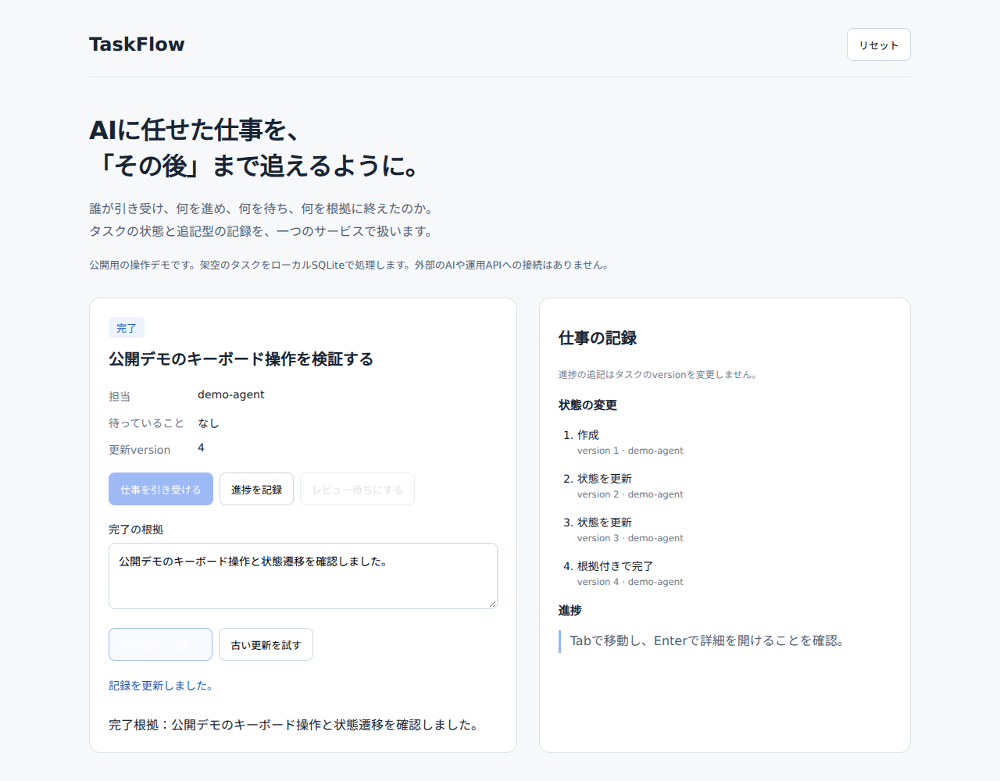

# TaskFlow

人とAIに任せた仕事を、担当、進捗、待機理由、完了の根拠で追うためのタスク管理です。
この公開版では、運用版の中核サービスをローカルSQLiteで動かし、状態の変更と記録の残り方を試せます。



## 解決したい課題

AIに仕事を頼むと、会話の中では進捗が分かっていても、あとから担当や結果を確認しにくくなります。
別のAIや人が引き継ぐときには、何を終え、何を待っているのかを説明し直す必要もあります。

TaskFlowでは、依頼から完了までをタスクとして扱います。
誰が引き受けたか、どの作業を進めたか、人の確認を待っているかを記録し、完了時には根拠を残します。
会話が切り替わったあとも、仕事の状態を確認できるようにすることが目的です。

## 設計で工夫したこと

状態を変える処理を`TaskService`に集めています。
APIやMCPの入力形式は契約定義で管理し、タスクのルールを呼び出し元ごとに作り直さない構成です。
公開デモの画面も、このサービスを直接呼び出します。

同じ依頼が再送されても、二重に記録しないように`request_id`を使います。
古い画面からの更新は`expected_version`で検出し、タスクと操作履歴を一つのトランザクションで保存します。
途中で失敗した場合に、一部の変更だけが残らないようにしています。

進捗の記録は追記型です。
進捗を書くだけではタスクのversionを変えず、状態の更新と分けて扱います。
完了操作には根拠が必要で、タスクの状態、入力形式、所有者の境界も検査します。

## 試す

Node.js 24とnpmを使います。
Node.jsに組み込まれたSQLiteを使うため、DBやクラウドの契約は不要です。

```sh
npm ci
npm start
```

`http://127.0.0.1:4174`を開き、「仕事を引き受ける」「進捗を記録」「レビュー待ちにする」の順に操作します。
確認結果を入力して完了すると、画面の右側で状態の変更履歴を確認できます。
「古い更新を試す」では、versionが進んだタスクへの古い更新が拒否される様子を見られます。

```sh
npm test
npm run demo
```

テストでは、重複送信、同時更新、途中失敗の取り消し、所有者の分離、完了根拠、進捗の追記を検証します。
`npm run demo`は一連の操作を実行し、結果を`output/scenario.json`に書き出します。

## 公開版の範囲

タスクと担当者は架空です。
デモのDBはメモリ内に作り、プロセスを終了すると消えます。
AIを実行する機能や、運用環境への接続はありません。

公開版には`TaskService`、契約定義、DB層、関連するマイグレーションとテストを含めています。
運用版の画面、OAuthサーバー、HTTP・MCPの配信処理、デプロイ設定は含みません。
外部通知用のコードは依存する型を保つために残していますが、デモでは生成・実行しません。
公開デモのHTTPサーバーはローカル確認用で、運用向けの認証を備えていません。

## コードを読む

まず[`src/v1/tasks/index.ts`](../src/v1/tasks/index.ts)の状態変更処理と、[`tests/v1-agent-work.test.ts`](../tests/v1-agent-work.test.ts)の失敗ケースを読むと、設計の意図を確認できます。
`demo/`は公開用に追加した画面と実行手順です。
TypeScript、Zod、SQLiteを使っています。

抽出元と変更箇所は[来歴](provenance.md)、確認結果は[動作確認](verification.md)に記載しています。
