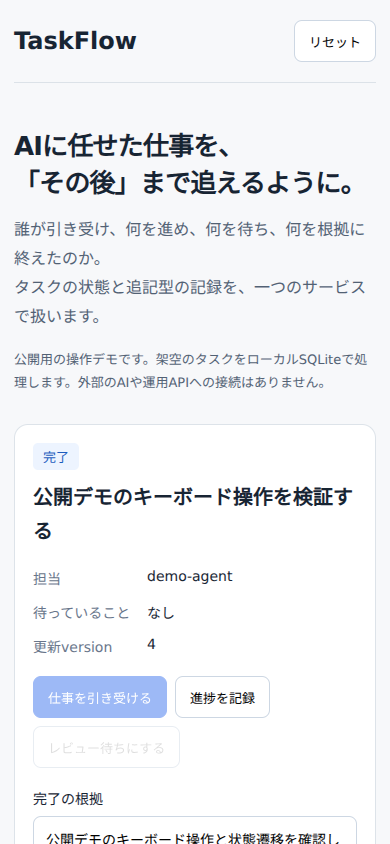

# 動作確認

2026年10月28日、Node.js 24.22.1とローカルSQLiteで確認しました。
`npm test`は33件成功、`npm run demo`も成功しました。
タスクの更新、重複依頼の再実行、競合、トランザクションの失敗、所有者の分離、追記型の進捗を検証しています。

画面はChromiumで、1280×1000と390×844の幅で確認しました。
クラウドブラウザがローカルサーバーへ接続できなかったため、ローカルのPlaywrightとChromiumを使用しています。

| 操作 | 確認した結果 |
| --- | --- |
| 仕事を引き受ける | 進行中になりversionが進む |
| 進捗を記録 | 記録が増え、タスクのversionは変わらない |
| レビュー待ちにする | 確認待ちになり待機理由が表示される |
| 古いversionで更新する | VERSION_CONFLICTで拒否される |
| 根拠を空にして完了する | VALIDATION_FAILEDで拒否される |
| 根拠を入力して完了する | 完了状態と根拠が表示される |
| モバイル幅で表示する | ページ全体の横はみ出しなし |
| 操作中のJavaScriptエラー | 検出なし |

古い更新と根拠のない完了を試した際のHTTP 409は、意図した拒否として確認しています。

公開用HTTPサーバーには、運用向けの認証、永続化、複数利用者の分離を実装していません。
ローカルのデモ用です。
運用版のOAuth、MCP通信、外部通知、D1上での負荷や遅延は、今回の確認に含みません。
実行時のIDと記録時刻は毎回変わります。




## README改訂時の再確認

Node.js 24.22.1で`npm ci`、`npm test`、`npm run demo`を再実行し、すべて成功しました。
テストは33件成功・失敗0件です。独立したbuildスクリプトはなく、Node.jsがTypeScriptを直接実行します。

```sh
node --test --experimental-test-coverage tests/*.test.ts
```

上記のall files集計（テスト用SQLiteアダプターを含む）は行70.62%、分岐89.65%、関数73.15%でした。
繰り返し処理などの未カバー領域があり、全機能の保証を示す数字ではありません。

Browser plugin not availableのため、Playwright 1.59.1とローカルGoogle Chromeを使用しました。
`npm start`で起動した`http://127.0.0.1:4174`に接続し、1120×1000と390×844で確認しました。
ページタイトルと本文を確認し、エラーオーバーレイ・想定外のconsole error・pageerrorは検出しませんでした。
引き受け→進捗追記（version不変）→レビュー待ち→古い更新の409 VERSION_CONFLICT→根拠なし完了の409 VALIDATION_FAILED→根拠付き完了を確認しました。
拒否後に確認待ち状態が維持されること、完了根拠が表示されること、モバイルで横はみ出しがないことも確認しました。
意図した409のリソースエラー表示はconsoleの異常判定から除外しています。

撮影対象は`demo/model.ts`の架空データのみです。新規画像とGIFの全フレームを開き、個人情報・実データ・ローカルパス・トークンが写っていないことを確認しました。
GIFは拒否操作を除いた正常系です。既存画像は残し、新しい画像をREADMEから相対参照しています。

- [正常系GIF](images/workflow.gif)
- [競合拒否](images/version-conflict.png)
- [根拠なし完了の拒否](images/evidence-required.png)
- [モバイル390×844](images/mobile-390.png)

この再確認はローカルの公開デモが対象です。OAuth・MCP配信・外部通知・本番D1・性能は未検証です。
